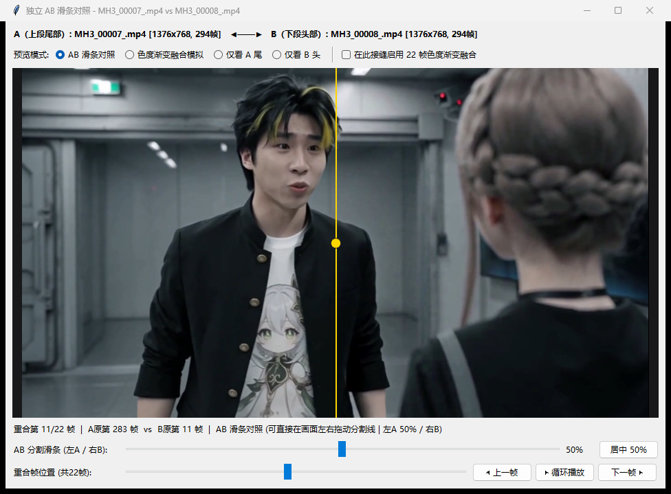
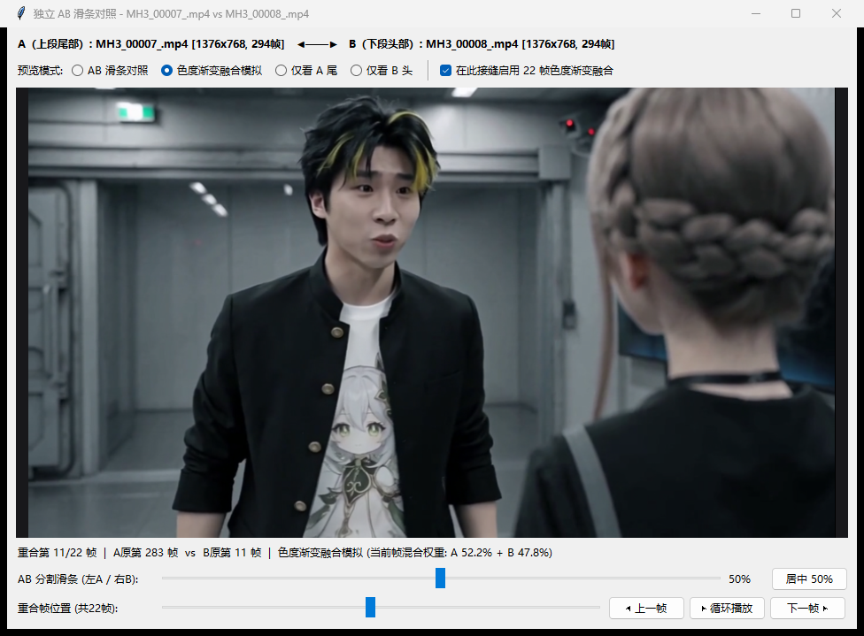

# Video Overlap Merger · 多段 AI 视频低内存流式裁剪拼接工具

一款专为 **AI 长视频分段生成后拼接**（如 Minimax H3 / 首尾帧 / 尾部参考续写工作流）打造的轻量级桌面工具。  
底层完全基于 **FFmpeg 流式管道**，替代传统 ComfyUI 中把所有视频展开为 `float32` 张量后再 `torch.cat` 合并的重内存方案，内存占用从数十 GB 降至百兆级，合并耗时从数分钟缩短至几秒钟。

---

## 核心特性

- **极低内存、秒级出片**：全程 FFmpeg 流式解码裁剪与编码，不将整片展开进系统内存，运行结束即释放，无缓存残留；默认优先调用 NVIDIA `h264_nvenc` GPU 硬件编码（不可用时自动回退 `libx264`）。
- **直接拖入 & 智能排序**：
  - 支持直接把视频文件或文件夹**拖入主窗口**（支持 `Ctrl+V` 从资源管理器粘贴、按钮添加、或直接拖到 `.exe` / `.bat` 上启动）。
  - **单个拖入**严格按拖入先后顺序拼接；**多选/文件夹拖入**支持一键**按文件名数字从小到大排序**（自然数字排序，避免 `10` 排在 `2` 前面）。
- **首帧 → 尾帧缩略图**：导入列表自动异步提取每段视频的首帧与尾帧并排展示，直观确认段与段之间是否顺畅衔接。
- **独立 AB 滑条对照窗口**：勾选任意两段视频即可弹出独立的对比预览窗口（仅提取重合区间的几十帧），通过**可拖动金色分割线**像素级比对上段尾部与下段头部的重合帧，快速排查偏色、曝光跳变或错位；支持循环播放与渐变效果预览。
- **逐接缝色度渐变融合**：当发现某两段重合部分有轻微跳色时，可**单独为该接缝开启 N 帧色度渐变融合**（视频 `blend` 线性交叉溶解 + 音频 `acrossfade` 交叉淡变），其余正常接缝保持硬切，且**成片总帧数、总时长与硬切完全一致**。
- **重叠帧数通用可配 & 音频公式自动计算**：默认第 2 段起裁掉前 `22` 帧（内置 `22帧(通用)`、`1帧(首尾帧)`、`0帧(直连)` 快捷按钮），音频裁剪时长无需手填，自动按公式计算：

$$\text{音频裁剪时长（秒）} = \frac{\text{裁剪帧数}}{\text{视频帧率}}$$

---

## 界面预览

以下界面截图展示两段 `1376×768`、`24 fps`、`294 帧 / 12.25s` 的首尾衔接分段视频（重合区间为 22 帧）的对照与合成效果：

### 1. 主界面与首尾帧缩略图


### 2. 独立 AB 滑条对照窗口（排查跳色）


### 3. 开启色度渐变融合模拟（消除接缝跳变）


---

## 快速开始

### 方式一：下载零依赖 Release 版（推荐 Windows 用户）

无需安装 Python，无需配置 FFmpeg 环境变量：

1. 前往本仓库右侧的 **[Releases](../../releases)** 页面，下载最新的 `VideoOverlapMerger-v1.0.0-win64.zip`。
2. 解压到任意英文或中文路径目录。
3. 双击运行 **`VideoOverlapMerger.exe`** 即可使用（压缩包内已自带 `ffmpeg.exe` 与 `ffprobe.exe`）。

### 方式二：从源码运行

需要系统已安装 **Python 3.11+**（需包含 `tkinter`）以及 **FFmpeg / FFprobe**（在系统 `PATH` 中）：

```bash
git clone https://github.com/robinxyz627/video-overlap-merger.git
cd video-overlap-merger
pip install -r requirements.txt
```

- 双击 **`start_video_merger.bat`** 启动图形界面（或直接把视频/文件夹拖到 `start_video_merger.bat` 上）；
- 也可以在命令行运行：`python merge_gui.py`。

---

## 详细使用教程

1. **导入分段视频**：
   - 打开 `VideoOverlapMerger.exe`（或 `start_video_merger.bat`），直接将装有分段视频的文件夹（或选中的多段 `.mp4` 文件）拖入窗口。
   - 列表会自动显示每段视频的 **首帧 → 尾帧缩略图**、分辨率、帧率、总帧数和音轨状态。
   - 如果需要自定义顺序，可一个一个拖入，或选中某行点击 **`↑ 上移` / `↓ 下移`**；批量拖入后也可点击 **`按文件名数字排序 (小→大)`**。
2. **检查接缝是否跳色（AB 滑条对照）**：
   - 在第一列 **`AB对照`** 勾选相邻两段视频（或直接选中后一段所在行），点击 **`打开独立 AB 滑条对照窗口`**。
   - 在独立窗口中，左右拖动画面上的金色分割线（或下方 **`AB 分割滑条`**），即可在同一帧上对比 `A（上段尾部）` 与 `B（下段头部）` 的色彩、亮度和人物位置是否一致；拖动 **`重合帧位置`** 滑条或点击 **`▶ 循环播放`** 可逐帧/动态查看全部 22 个重合帧。
3. **按需开启色度渐变融合**：
   - 若对比发现两段衔接几乎无跳色，保持默认的 **`硬切去重 (裁前22帧)`** 即可；
   - 若发现重合部分存在色偏或亮度跳变，可直接在 AB 窗口顶部勾选 **`在此接缝启用 22 帧色度渐变融合`**（或在主窗口双击该行），并切到 **`色度渐变融合模拟`** 模式预览平滑过渡效果。
4. **调整重叠帧数并导出**：
   - 如果是“首尾帧参考”工作流，只需点击参数区的 **`1帧(首尾帧)`**；如果是“尾部 22 帧参考”工作流，保持 **`22帧(通用)`**；如果不裁切直接拼接，点 **`0帧(直连)`**。
   - 右侧 **`音频裁剪公式(自动)`** 会自动计算并显示 `22 ÷ 24 fps = 0.9167 秒`（或 `1 ÷ 24 fps = 0.0417 秒`）。
   - 点击右下角 **`开始合并输出`**，等待数秒即可完成（两段 294 帧拼接后预计成片 `566 帧 / 23.58 秒`）。

---

## 拼接原理说明

假设第 1 段视频共 $L_1$ 帧，第 2 段视频共 $L_2$ 帧，重叠帧数为 $N$（如 $N = 22$）：

| 模式 | 视频处理方式 | 音频处理方式 | 合并后总帧数 |
| :--- | :--- | :--- | :--- |
| **硬切去重**（默认） | 保留第 1 段全部帧 + 裁掉第 2 段前 $N$ 帧（`trim=start_frame=N`） | 保留第 1 段音频 + 裁掉第 2 段前 $N/\text{fps}$ 秒（`atrim`） | $L_1 + L_2 - N$ |
| **色度渐变融合** | 第 1 段末尾 $N$ 帧与第 2 段开头 $N$ 帧按权重 $\alpha_k = \frac{k+1}{N+1}$ 逐帧线性混合（`blend`） | 在接缝处执行对应时长 $N/\text{fps}$ 秒的三角交叉淡变（`acrossfade`） | $L_1 + L_2 - N$ |

- 若存在部分片段无音轨而其他片段有音轨，工具会自动为无音轨片段补齐等长静音音轨（`anullsrc`），防止 `concat` 失败或音画错位。

---

## 命令行模式（CLI）

除了图形界面，`merge_videos.py` 也支持纯命令行调用，适合批量脚本集成：

```bash
# 按文件名数字排序合并整个目录（默认裁前 22 帧，自动 GPU 硬编）
python merge_videos.py ./clips -y

# 首尾帧工作流（第 2 段起仅裁前 1 帧）
python merge_videos.py clip1.mp4 clip2.mp4 clip3.mp4 -f 1 --sort manual -y -o out.mp4

# 仅对第 1->2 段与第 3->4 段接缝开启 22 帧色度渐变，其余保持硬切
python merge_videos.py ./clips --blend 1-2,3-4 -y

# 对所有接缝开启色度渐变，强制使用 CPU libx264 编码
python merge_videos.py ./clips --blend all --encoder x264 -y
```

---

## 自行打包 Release

如需自行构建免安装 Windows 发布包（基于 PyInstaller）：

```powershell
pip install pyinstaller
powershell -ExecutionPolicy Bypass -File .\build_release.ps1
```

构建完成后会在 `release_pkg/` 生成 `VideoOverlapMerger-v1.0.0-win64.zip`。

---

## 开源协议

- 本项目源码基于 [MIT License](LICENSE) 开源。
- Release 发布包内捆绑的 `ffmpeg.exe` / `ffprobe.exe` 遵循其原始协议（GPLv3），详见 [THIRD_PARTY_LICENSES.txt](THIRD_PARTY_LICENSES.txt)。
